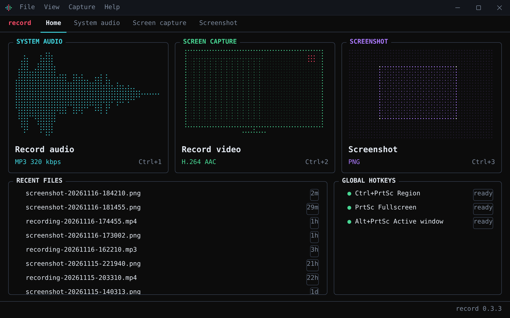
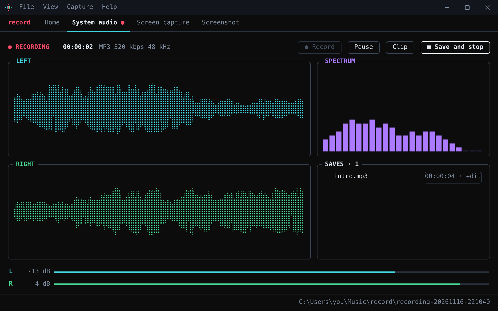
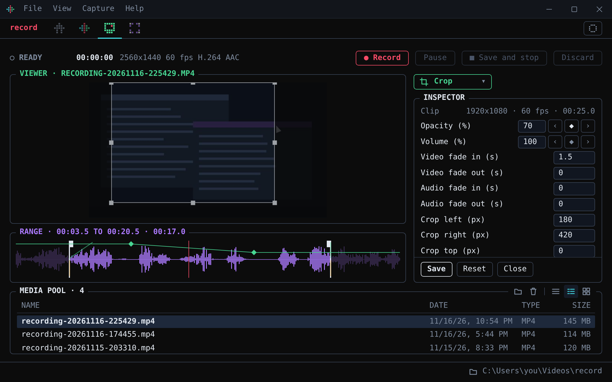
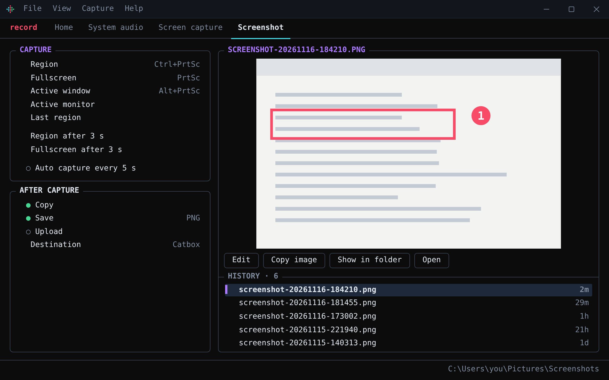

# record

> System audio to MP3, the screen to MP4, and HDR-correct screenshots on Windows. Native code, one small executable, no FFmpeg.

[](LICENSE)
[](#platform)

| Benchmark | Result |
|---|---:|
| `record` to active audio capture | **26.76 ms** median |
| `record --version` | **12.64 ms** median |
| `record.exe`, the terminal program | **5.20 MiB** |
| `record-desktop.exe`, the window with tray and editors | **9.37 MiB** |



## Benchmarks

### Startup

The clock starts at the first instruction of `main`. It stops when the MP3 writer is open and WASAPI loopback capture runs. `RECORDING` appears only after that point.

| Metric | Median | Minimum | Budget |
|---|---:|---:|---:|
| Audio capture ready | 26.76 ms | 22.60 ms | 100 ms |
| CLI process | 12.64 ms | 11.25 ms | 50 ms |

Release build, 3 warmup runs, 30 measured runs, Windows 11 Pro N build 26200, AMD Ryzen 5 5600X, 2026-08-20. Run it on your computer:

```powershell
.\scripts\benchmark-startup.ps1 -Runs 30 -Enforce
```

### Size

| File | Bytes | Size |
|---|---:|---:|
| `record.exe` | 5,453,824 | 5.20 MiB |
| `record-desktop.exe` | 9,821,696 | 9.37 MiB |

Release profile, `x86_64-pc-windows-gnu`, 2026-11-16. `record.exe` needs no other file. `record-desktop.exe` uses the WebView2 that Windows 11 includes.

The [benchmark notes](benchmarks/README.md) define each metric.

## Screens

| System audio | Video editor |
|---|---|
|  |  |

| Screenshot | Terminal |
|---|---|
|  |  |

The desktop pictures show the interface with its built-in demo signal.

## Install

```powershell
irm https://raw.githubusercontent.com/irbto/record/main/install.ps1 | iex
```

This installs `record.exe` to `%LOCALAPPDATA%\Programs\record` and adds it to `PATH`. You can also download [record.exe](https://github.com/irbto/record/releases/latest/download/record.exe) and run it from any folder.

The desktop program builds from source:

```powershell
git clone https://github.com/irbto/record
cd record
.\scripts\build-install.ps1
```

## Use

| Command | Result |
|---|---|
| `record` | System audio to MP3, 320 kbps. Session folder with parts and named clips |
| `record video` | One monitor and system audio to H.264/AAC MP4, then the clip editor |
| `record screenshot` | Region, window, monitor, or all screens. Annotate, copy, save, upload |
| `record screenshot --tray` | Screenshot hotkeys from the notification area |
| `record-desktop` | All of it in one window with a tray icon |

Screenshots of HDR monitors keep the colors that you see. Files save as PNG, JPEG, WebP, BMP, GIF, or TIFF. Uploads use any ShareX custom uploader file.

## Documentation

- [Guide](docs/guide.md): every command, key, and setting
- [Architecture](docs/architecture.md)
- [Benchmark notes](benchmarks/README.md)
- [Changelog](CHANGELOG.md)
- [Contributing](CONTRIBUTING.md)

## Platform

Windows 10 and Windows 11. System audio is the shared-mode mix of the default playback device. Microphone input, exclusive-mode streams, and protected media are not part of it.

[MIT License](LICENSE)
