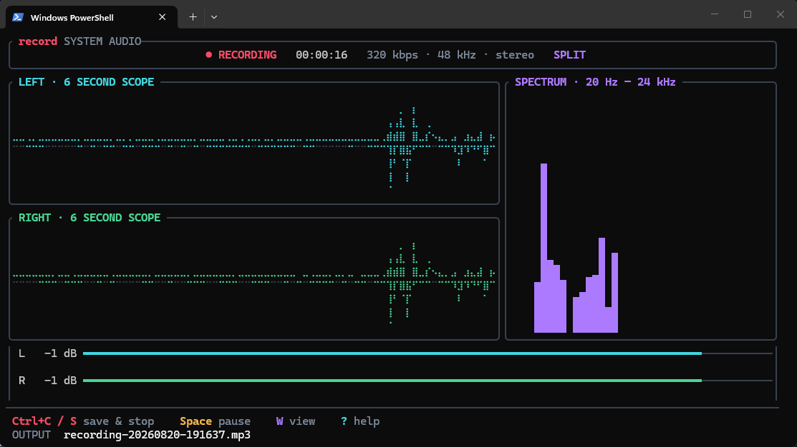

# record

> Type `record` for MP3 system audio. Type `record video` for H.264/AAC MP4 screen capture. Type `record screenshot` for annotated, HDR-correct PNG screenshots.

[](LICENSE)
[](#platform-support)

## HDR screenshots that look right

**Turn on HDR, take a screenshot, and get the colors you see.**

Many capture tools read an HDR desktop as plain 8-bit color, so the picture comes out bright and washed out. `record screenshot` reads the HDR surface and maps it to sRGB with the SDR white level of your monitor. It needs no setting and no color profile. SDR monitors use the direct path and are not changed.

Read [HDR monitors](#hdr-monitors) for the details.

## Fast by design

**26.76 ms median to active system audio capture.**

The primary startup metric measures time from process entry to active WASAPI loopback capture. It also verifies that the native MP3 sink is ready.

The `RECORDING` state appears only after the MP3 writer opens and `IAudioClient::Start` succeeds. Thus, `record` means that audio capture is active.

| Reference metric | Median | Minimum | Budget |
|---|---:|---:|---:|
| Audio capture ready | 26.76 ms | 22.60 ms | 100 ms |
| CLI process | 12.64 ms | 11.25 ms | 50 ms |

These results use Windows 11 Pro N build 26200 and an AMD Ryzen 5 5600X. Results on other computers can be different.

Read the [benchmark notes](benchmarks/README.md) for the metric definitions. You can also run the benchmark on your computer.



## Record with one command

`record` is a native Windows terminal program. It records system audio from the default output device. It does not record microphone audio.

```powershell
record
```

Capture starts without a source menu. `record` creates a timestamped session folder in the current directory.

The session starts with `part-001.mp3`. It starts a new MP3 at each exact ten-minute boundary. Press `Ctrl+C` to finalize the current part.

The final folder path is clickable in terminals that support OSC 8. Use `-o FILE.mp3` when you need one MP3 instead of a session.

## Features

- `record` captures applications that send audio to the default playback device.
- Windows Media Foundation writes a stereo MP3. The default bitrate is 320 kbps.
- The TUI starts in split view. It shows left and right waveforms, level meters, and a spectrum.
- Ten-minute MP3 parts limit the effect of a process or computer failure.
- `C` names the current part as a clip. Capture continues in a new part.
- The saves panel shows each finalized part and clip during the session.
- The clip editor changes start and end points. It previews only the selected content.
- The clip editor writes a new MP3 and replaces the old clip only after finalization.
- `Ctrl+C`, `S`, `Q`, and `Esc` stop capture and finalize the MP3.
- The saved file name is a clickable link in terminals that support OSC 8.
- Pause, timed capture, selected output paths, and headless operation are available.
- One native executable contains the program. FFmpeg and runtime services are not necessary.

## Install

### PowerShell installer

Use this command. You do not need Rust or FFmpeg.

```powershell
irm https://raw.githubusercontent.com/irbto/record/main/install.ps1 | iex
```

The installer does these tasks:

1. It downloads the latest `record.exe`.
2. It verifies the SHA-256 checksum.
3. It installs the file in `%LOCALAPPDATA%\Programs\record`.
4. It adds that directory to the current shell and the persistent user `PATH`.

You can use `record` immediately after the installer is complete.

### Portable executable

Download [record.exe](https://github.com/irbto/record/releases/latest/download/record.exe) from the [latest GitHub release](https://github.com/irbto/record/releases/latest). You can start this file without installation.

The release also contains a ZIP file and SHA-256 checksum files.

### Cargo

Use Cargo if its binary directory is already on `PATH`.

```powershell
cargo install --git https://github.com/irbto/record --locked
```

Cargo puts executables in `CARGO_HOME\bin`. The usual directory is `%USERPROFILE%\.cargo\bin`.

A standard rustup installation adds this directory to `PATH`. If Cargo gives a `PATH` warning, use the PowerShell installer.

## Controls

| Key | Action |
|---|---|
| `Ctrl+C`, `S`, `Q`, `Esc` | Stop capture, finalize the current MP3, and exit |
| `Space` | Pause or continue capture |
| `W` | Select waveform, spectrum, or split view |
| `C` | Enter a name and finalize the current part as a clip |
| `Up`, `Down` | Select a finalized file in the saves panel |
| `E` | Open the selected named clip in the editor |
| `?` | Show or hide help |

Paused time is not in the MP3.

### Clip editor

The editor operates on the selected named clip. It does not change automatic session parts.

| Key | Action |
|---|---|
| `Tab` | Select the start or end handle |
| `Left`, `Right` | Move the selected handle by 0.1 seconds |
| `Shift+Left`, `Shift+Right` | Move the selected handle by 1 second |
| `Ctrl+Left`, `Ctrl+Right` | Move the selected handle by 0.01 seconds |
| `P` | Start or stop a preview of the selected content |
| `R` | Restore the full clip range |
| `Enter` | Save the selected range as the clip MP3 |
| `Esc` | Close the editor and keep the current MP3 |

Preview pauses capture. This prevents `record` from capturing its own preview. Capture returns to its previous pause state after preview.

## CLI

```text
record [OPTIONS]
record doctor

Options:
  -o, --output <FILE>       Write one MP3 instead of a session directory
  -b, --bitrate <BITRATE>   k128, k192, k256, or k320 [default: k320]
  -d, --duration <SECONDS>  Stop automatically, including fractional seconds
      --part-minutes <MINUTES>
                            Session part length [default: 10]
      --no-tui              Use line output for scripts or pipes
  -f, --force               Replace an existing output file
```

Examples:

```powershell
# Start capture. Press Ctrl+C to stop.
record

# Use five-minute session parts.
record --part-minutes 5

# Record a 30-second file at 192 kbps.
record -d 30 -b k192 -o demo.mp3

# Test the audio endpoint and MP3 encoder. Do not record audio.
record doctor
```

## Screen recording

`record video` captures the primary monitor and system audio into one MP4 with H.264 video and AAC audio. DXGI supplies the desktop from the GPU framebuffer, and Media Foundation selects the installed NVIDIA, AMD, or Intel hardware H.264 transform when available. Capture starts immediately and shows the desktop as a real raster video surface in Windows Terminal 1.22 or newer. Windows Terminal 1.23 or newer presents each Sixel frame as one synchronized update so playback does not flash between pictures.

Press `Ctrl+C` or `S` to stop capture and finalize the MP4. The same window then opens the video clip editor with a full-width audio waveform aligned to the clip range and playhead. `T` selects the range handles, `V` selects video fade-in/out, `A` selects audio fade-in/out, and `C` selects the four crop edges; press a shortcut again to cycle that tool's handles. `Tab` and `Shift+Tab` move through every handle, and the arrow keys adjust the selected value. Fade adjustments use 0.1 second normally, one second with `Shift`, or one frame with `Ctrl`. Crop edges use two-pixel steps normally or 20 pixels with `Shift`, and the preview dims the area that will be removed.

`Space` starts or pauses playback and resumes from the current frame, `Backspace` returns to the range's start marker, `R` resets every edit, `Enter` applies the selected range, fades, and crop, and `Esc` keeps the original file. Cropping reduces the encoded output dimensions shown in the edit-tool strip. `--no-tui` skips both the live preview and editor for scripts.

```text
record video [OPTIONS]

Options:
  -o, --output <FILE>         MP4 destination. Omit for a timestamped file
      --video-bitrate <MBPS>  H.264 bit rate in megabits [default: 20]
      --audio-bitrate <KBPS>  AAC bit rate in kilobits [default: 192]
      --monitor <MONITOR>     primary, an index number, or list [default: primary]
      --fit <MODE>            contain, cover, stretch, or native [default: contain]
      --canvas <CANVAS>       WxH or preset: native, 1080p, 1440p, 4k, 720p, square
      --crop <CROP>           LEFT,TOP,WIDTH,HEIGHT in source pixels
      --fps <FPS>             Capture frame rate [default: 60]
  -d, --duration <SECONDS>    Stop automatically
  -f, --force                 Replace an existing output file
```

Examples:

```powershell
# Capture the primary monitor at source resolution.
record video

# List every attached monitor.
record video --monitor list

# Capture monitor 1 at 1080p with contain fit.
record video --monitor 1 --canvas 1080p

# Crop to the top-left quadrant and encode at 720p.
record video --crop 0,0,1280,720 --canvas 720p
```

The recorder supports MP3 and MP4 only. No other container or codec is supported.

Windows blocks desktop duplication for protected content such as Netflix or Blu-ray players. Those windows appear black in the recording. The recorder also stops when Windows switches to the secure desktop (UAC prompt or lock screen) and recovers when you return to the normal desktop.

HDR displays are captured and encoded as SDR. The DXGI desktop duplication API returns SDR-mapped frames on HDR displays, so no tone mapping is needed. Colors may look slightly different from the HDR display.
## Screenshots

`record screenshot` opens the screenshot hub in the terminal. The hub has a capture menu, a preview of the selected screenshot, and a history of the screenshots folder. Global hotkeys work while the hub is open.

| Capture | Hotkey | Hub key |
|---|---|---|
| Region with annotation overlay | `Ctrl+PrtSc` | `R` |
| Fullscreen, all monitors | `PrtSc` | `F` |
| Active window | `Alt+PrtSc` | `W`, after 3 seconds |
| Active monitor | | `M` |
| Last region | | `L` |
| Region in 3 seconds | | `D` |
| Auto capture on or off | | `A` |
| Screen recording in a new window | | `V` |

`Tab` moves between the menu and the history. `Enter` runs the selected entry or opens the selected image. `C` copies the selected image, `O` opens the screenshots folder, `U` and `P` control uploads, and `Q` quits. The hub shows `in use` beside a hotkey that another program holds.

Each capture writes a PNG to `Pictures\Screenshots` and places the image on the clipboard. The after-capture switches in the menu turn each task on or off, and the hub remembers them.

### Settings

Press `S`, or select `Settings`, to change the defaults:

| Setting | Meaning |
|---|---|
| Screenshots folder | Folder for new screenshots and for the history |
| Delay of delayed captures | Seconds that `Region in N seconds` and the menu entry `Active window` wait |
| Auto capture interval | Seconds between two auto captures |
| Monitor | The monitor under the pointer, or the primary monitor |
| HDR: SDR white level | A fixed level in nits, or the value from Windows |
| Start in the tray at sign-in | Adds or removes a sign-in entry for the current user that runs `record screenshot --tray` |

The hub stores the settings in `%APPDATA%\record\screenshot-settings.txt`. Direct capture and the tray process use the same values. An option on the command line overrides a stored value for that run.

### Region overlay

A region capture copies the monitor under the mouse pointer from the GPU and freezes it in a borderless window on that monitor. A toolbar of icons floats on the frozen picture. Rest the pointer on an icon to see its name and its key. Drag to select the region to keep, draw on the picture, and press `Enter`. The overlay is a native window, because a terminal cannot draw over the desktop. The toolbar and the dimmed area outside the selection are never part of the image.

| Key | Tool or action |
|---|---|
| `S` | Select the region to keep. Drag inside the region to move it |
| `R`, `E`, `L`, `A`, `P` | Rectangle, ellipse, line, arrow, freehand pen |
| `T` | Text. Click, type, and press `Enter` |
| `H` | Marker highlight |
| `X`, `B` | Pixelate or blur a rectangle |
| `N` | Step number. Each click places the next number |
| `O` | Spotlight. Darkens everything outside a rectangle |
| `D` | Eraser. Covers a rectangle with the color under the start of the drag |
| `1` to `6` | Select a color |
| `[`, `]`, mouse wheel | Change the stroke, text, block, or blur size |
| Arrow keys | Move the selection by one pixel. `Shift` changes its size |
| `Ctrl+Z`, `Ctrl+Y` | Undo or redo |
| `Tab` | Move the toolbar to the other screen edge |
| `Enter`, `Ctrl+S` | Finish and run the after-capture tasks |
| `Ctrl+C` | Copy the image and do not write a file |
| `Esc` | Cancel the text or drag in progress. Otherwise close and discard |

Without a selection, the image contains the complete monitor.

### Notification area

`record screenshot --tray` starts a background process with an icon in the notification area and returns to the prompt at once. The same three hotkeys work. A left click on the icon starts a region capture. A right click opens the capture menu, which also contains Quit.

### Direct capture

A mode after the command captures at once and exits. This form does not open the hub.

```text
record screenshot [MODE] [OPTIONS]

Modes:
  region   Select and annotate a region on a frozen monitor
  full     Every monitor as one image
  monitor  The monitor under the mouse pointer
  window   The active window
  last     The last region again

Options:
  -o, --output <FILE>      PNG destination. Omit for a timestamped file
      --dir <FOLDER>       Folder for timestamped files
      --monitor <MONITOR>  pointer, primary, or an index number
      --region <REGION>    Capture LEFT,TOP,WIDTH,HEIGHT in desktop pixels
  -d, --delay <SECONDS>    Wait before the capture
      --every <SECONDS>    Auto capture: repeat at this interval
      --count <COUNT>      Auto capture: stop after this many captures
      --no-copy            Do not place the image on the clipboard
      --sdr-white <NITS>   Override the SDR white level of an HDR monitor
      --upload [<DEST>]    Upload each image and copy its link
  -f, --force              Replace an existing output file
      --tray               Run in the notification area
```

```powershell
# Capture the active window after two seconds.
record screenshot window -d 2

# Capture a fixed rectangle every 10 seconds until Ctrl+C.
record screenshot --region 0,0,1280,720 --every 10
```

### Upload

The hub sets up uploads. Press `P`, or select `Destination`, to open the destination list:

- **Imgur** and **ImgBB** ask for their API key the first time and store it. Press `K` on the row to change the key later.
- **Catbox** needs no account.
- **Litterbox** needs no account and deletes each file after 72 hours.
- **Import a .sxcu file** asks for the path of a ShareX custom uploader file and copies it into `%APPDATA%\record\uploaders`.
- Each imported file appears in the list by its name.
- **Off** keeps images on this computer.

`U` turns `Upload and copy link` on or off. With uploads on, each capture goes to the destination and the clipboard holds the link instead of the image. The hub stores the destination and the three after-capture switches, and the tray process uses the same choices.

When an upload fails, the image still goes to the file and to the clipboard, and the status line shows the reason. Each finished upload adds a line with its link and its deletion link to `%APPDATA%\record\uploads.log`.

`record` reads ShareX custom uploader (`.sxcu`) files, so a configuration that a service publishes for ShareX works without changes. It supports the `MultipartFormData` and `Binary` body types and the `{json:path}`, `{response}`, `{header:name}`, and `{filename}` expressions. It rejects a file that needs another body type or expression and names the reason.

Direct capture uploads only with `--upload`:

```powershell
record screenshot full --upload
record screenshot full --upload catbox
record screenshot region --upload C:\configs\zipline.sxcu
```

Without a value, `--upload` uses the destination that the hub stored.

### HDR monitors

Windows composes an HDR desktop in linear scRGB, where SDR content sits at the SDR white level of the monitor. Tools that read that surface as plain 8-bit color produce bright, washed-out pictures. `record screenshot` requests the half-float surface, divides it by the SDR white level that Windows reports for the monitor, and encodes the result as sRGB. SDR windows keep their original colors. HDR highlights above SDR white scale down to white without a hue change.

The status line shows the SDR white level that the conversion used. Use `--sdr-white` if a picture is too bright or too dark.

## Desktop program

`record-desktop` is one window for all three kinds of recording. It uses the same engines and the same stored settings as the terminal program. The window is a [Tauri](https://tauri.app) program: the engines stay in Rust, and the interface is a small web page that Windows draws with its own WebView2.

The window opens on **Home**. Home has one large button for each mode, the most recent files, and the state of the global hotkeys. Tabs at the top switch between Home, System audio, Screen capture, and Screenshot.

- **System audio** shows the time, two six-second scopes, the spectrum, and the left and right levels. It writes MP3 files to `Music\record`.
- **Screen capture** selects the monitor and the frame rate and shows a live picture. It writes MP4 files to `Videos\record`.
- **Screenshot** has the capture list, the after-capture switches, the upload destination, and the history with a preview. The window minimizes during a capture, so it is never in its own picture.

The window draws its own title bar in place of the Windows frame. Drag it to move the window, and double-click it to maximize. The title bar holds the menus. **File** starts, pauses, and saves a recording and opens Settings. **View** switches screens. **Capture** has every screenshot mode and the upload destination. **Help** lists the keys.

| Key | Action |
|---|---|
| `Ctrl+0` to `Ctrl+3` | Home, System audio, Screen capture, Screenshot |
| `Ctrl+R` | Start recording |
| `Space` | Start, pause, or resume |
| `Ctrl+P` | Pause or resume |
| `Ctrl+S` | Save and stop |
| `Ctrl+O` | Open the output folder |
| `Ctrl+D` | Upload destination |
| `Ctrl+,` | Settings |
| `Alt+F`, `Alt+V`, `Alt+C`, `Alt+H` | Open a menu |

The screenshot hotkeys `Ctrl+PrtSc`, `PrtSc`, and `Alt+PrtSc` work in every program while the window is open.

One audio or video recording runs at a time. The tab of the mode that records shows a red dot, and the other screens stay reachable. If you close the window during a recording, the program saves the file first.

To add a ShareX custom uploader, drop its `.sxcu` file on the window.

```powershell
cargo build --release -p record-desktop
target\release\record-desktop.exe
```

The build needs only Rust. The interface is in `crates/record-desktop/ui`, and its built form in `ui/dist` is part of the repository. To change the interface, edit `ui/src` and run `npm install` and `npm run build` in `crates/record-desktop/ui`. Open `ui/dist/index.html` in a browser to see the interface with a simulated signal.

Windows 11 includes WebView2. Windows 10 gets it with Microsoft Edge.

The terminal program has more options for each mode, such as session folders, clips, and crop.

## Startup design

The no-argument path does not start the general CLI parser. It creates the session and starts the audio worker before it starts the TUI.

The audio worker opens the MP3 writer and starts the WASAPI client. It then sends the `AudioEvent::Started` event.

The TUI shows `STARTING` before this event. It shows `RECORDING` only after this event.

The waveform history grows as necessary. The FFT planner starts after the first sample block for a spectrum view.

A bounded channel carries visualization data. The audio thread does not wait for terminal rendering.

Read the [architecture notes](docs/architecture.md) for more information.

Run the startup benchmark with this command:

```powershell
.\scripts\benchmark-startup.ps1 -Runs 30 -Enforce
```

## Platform support

Windows 10 and Windows 11 are supported. macOS and Linux capture backends are not available.

System audio is the shared-mode mix from the current default playback endpoint. `record` does not capture audio from a different device.

Protected media, exclusive-mode streams, and microphone input are not part of this mix.

## Project status

This is an early open-source release. Windows capture, rotation, preview, trimming, and native MP3 encoding have hardware smoke tests.

Device switching, metadata, and other operating systems are future work.

Read [CONTRIBUTING.md](CONTRIBUTING.md) before you send a change. This project uses the [MIT License](LICENSE).
